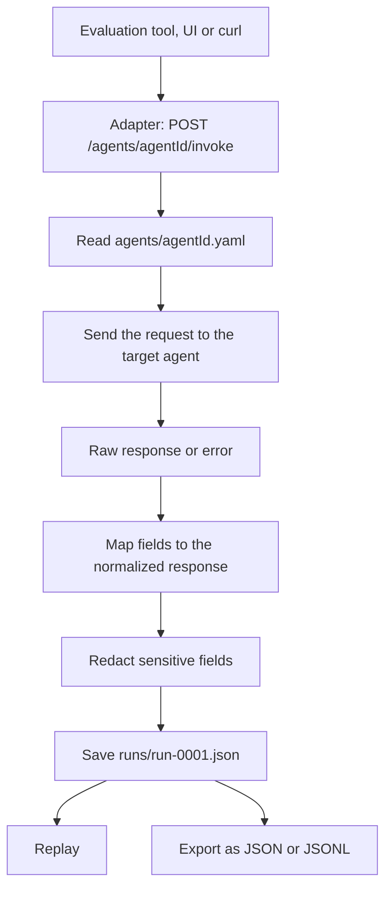

# Agent Evaluation Adapter

A small API adapter and run recorder for AI agents. It sits between an evaluation tool and a target agent. It sends the request to the agent, keeps the raw response, maps it to one common format through a YAML file, and stores every call as a run that can be replayed and exported.

The first target agent is the [Warehouse Outbound Invoice Agent](https://github.com/beratmertkayacan/warehouse-invoice-agent). A second mock agent with a different API shape is included to show that a new agent needs only a configuration file.

This project does not evaluate agents. It prepares clean and repeatable data for evaluation tools.

## How it works



The main design rule is **agent details live in configuration, not in code**.

- The adapter code does not know any agent. It only reads a YAML file.
- A failed call never crashes the adapter. The error is stored inside the run.
- A stored run is never changed or overwritten.
- Sensitive values are removed before anything is written to disk.

## Project layout

```
.
├── adapter/
│   ├── main.py          # FastAPI app, endpoints and error handlers
│   ├── __main__.py      # python -m adapter, starts the server on PORT
│   ├── service.py       # invoke and replay flow, session reuse
│   ├── agent_config.py  # reads and lists the agent YAML files
│   ├── client.py        # HTTP call to the target agent, error types
│   ├── mapping.py       # reads nested JSON paths such as result.message
│   ├── normalize.py     # builds the normalized response and the run record
│   ├── redaction.py     # hides sensitive fields
│   ├── recorder.py      # saves, lists and reads runs
│   ├── export.py        # turns runs into a JSON or JSONL dataset
│   ├── models.py        # Pydantic models
│   ├── config.py        # settings from environment variables
│   └── static/          # playground UI (index.html, app.js)
├── agents/              # one YAML file per agent
├── mock_agent/          # second example agent with a different API shape
├── samples/
│   ├── requests/        # request bodies for the demo cases
│   └── runs/            # recorded runs from the real Warehouse Agent
├── tests/               # pytest tests
├── replay.py            # python replay.py run-0005
├── export.py            # python export.py --format jsonl
├── .env.example
├── pyproject.toml
├── requirements.txt
└── requirements-dev.txt
```

## Installation

```bash
git clone https://github.com/beratmertkayacan/agent-eval-adapter.git
cd agent-eval-adapter
python3 -m venv .venv
source .venv/bin/activate
pip install -r requirements-dev.txt
cp .env.example .env
```

## Configuration

| Variable | Meaning | Default |
|---|---|---|
| `TARGET_AGENT_BASE_URL` | Base URL of the Warehouse Agent | `http://127.0.0.1:8000` |
| `MOCK_AGENT_BASE_URL` | Base URL of the mock agent | none, set it in `.env` |
| `PORT` | Port for `python -m adapter` | `8001` |

No URL, key or credential is written in the code or in the agent files. Each agent file only names the environment variable that holds its base URL.

## How to run

The adapter needs a target agent to talk to. Start each service in its own terminal.

```bash
# 1. Warehouse Agent (see its own README), on port 8000
python -m app

# 2. Mock agent, on port 8002 (optional)
uvicorn mock_agent.main:app --port 8002

# 3. Adapter, on port 8001
python -m adapter
```

Then open `http://127.0.0.1:8001/` for the playground or `http://127.0.0.1:8001/docs` for the API documentation.

## API endpoints

| Method | Path | Description |
|---|---|---|
| `GET` | `/agents` | List the configured agents |
| `POST` | `/agents/{agentId}/invoke` | Call an agent and record the run |
| `GET` | `/runs` | List all runs |
| `GET` | `/runs/{runId}` | Get one run |
| `POST` | `/runs/{runId}/replay` | Send a stored run again as a new run |
| `GET` | `/sessions/{sessionId}/runs` | List the runs of one session |
| `GET` | `/export?format=json` | Export runs, `json` or `jsonl` |
| `GET` | `/health` | Health check |
| `GET` | `/` | Playground UI |

Errors of the adapter itself use one JSON shape:

| Code | When | Example |
|---|---|---|
| `400` | The request cannot be used | `{"error": "Run run-0001 belongs to agent mock-agent"}` |
| `404` | The agent or the run does not exist | `{"error": "Run not found: run-0042"}` |
| `422` | The request body is not valid | `{"error": "Invalid request: input: Field required"}` |

## How to invoke an agent

Send text or a JSON object in `input`.

```bash
curl -s -X POST http://127.0.0.1:8001/agents/warehouse-agent/invoke \
  -H "Content-Type: application/json" \
  -d @samples/requests/case1_valid.json
```

- Text input is placed in the field named by `inputField` in the agent file. For the Warehouse Agent the body becomes `{"message": "..."}`.
- A JSON object is sent to the agent as it is.

The response is the full run record. It holds the raw response and the normalized response side by side:

```json
{
  "runId": "run-0001",
  "agentId": "warehouse-agent",
  "sessionId": "sess-aaca6037",
  "previousRunId": null,
  "turn": 1,
  "replayOf": null,
  "timestamp": "2026-11-12T11:45:58Z",
  "request": { "input": "...", "sessionId": null, "body": { "message": "..." } },
  "rawResponse": { "...": "the answer of the agent, unchanged" },
  "normalizedResponse": {
    "runId": "run-0001",
    "sessionId": "sess-aaca6037",
    "agentId": "warehouse-agent",
    "timestamp": "2026-11-12T11:45:58Z",
    "latencyMs": 2178,
    "request": { "input": "..." },
    "response": { "answer": "...", "status": "awaiting_approval" },
    "observability": {
      "toolCalls": [{ "name": "get_order" }, { "name": "get_stock" }, { "name": "submit_for_human_approval" }],
      "approval": { "id": "APR-001", "status": "pending", "summary": "..." },
      "requestId": "REQ-001",
      "auditId": null
    },
    "error": null
  },
  "httpStatus": 200,
  "latencyMs": 2178,
  "error": null
}
```

`answer` can be a string, an object or an array, because agents return different shapes.

### Multi turn sessions

To continue a conversation, send the ID of the previous run:

```bash
curl -s -X POST http://127.0.0.1:8001/agents/warehouse-agent/invoke \
  -H "Content-Type: application/json" \
  -d '{"input": "second message", "previousRunId": "run-0001"}'
```

The adapter reads the session ID that the agent returned in that run and sends it in the field named by `sessionField`. The new run stores `previousRunId` and `turn`, so the order of the turns can be read from the files. A run of one agent cannot be continued with another agent.

## How to add a new agent mapping

1. Create `agents/<agent-id>.yaml`. The file name is the agent ID. Use lowercase letters, numbers and dashes.
2. Add the base URL of the agent to `.env` under the name you chose in `baseUrlEnv`.
3. Restart the adapter. The agent appears in `GET /agents` and in the playground.

No source code change is needed. This is the mapping of the mock agent:

```yaml
agentId: mock-agent

# Name of the environment variable that holds the base URL of this agent.
baseUrlEnv: MOCK_AGENT_BASE_URL

request:
  endpoint: /run
  method: POST
  inputField: query
  sessionField: conversationId

responseMapping:
  answer: result.message
  status: result.state
  sessionId: conversation.id
  toolCalls: actions
  auditId: trace.id
```

| Key | Meaning | Default |
|---|---|---|
| `agentId` | Name of the agent | required |
| `baseUrlEnv` | Environment variable with the base URL | `TARGET_AGENT_BASE_URL` |
| `request.endpoint` | Path on the agent | required |
| `request.method` | `POST` or `GET` | `POST` |
| `request.inputField` | Field for text input | `input` |
| `request.sessionField` | Field for the session ID | none, no session is sent |
| `request.timeoutSeconds` | Time limit for one call | `30` |
| `responseMapping` | Where each normalized field is in the agent response | required |
| `redactFields` | Extra field names to hide in stored runs | empty |

In `responseMapping` the left side is the normalized field and the right side is the path in the agent response. Allowed fields are `answer`, `status`, `sessionId`, `toolCalls`, `approval`, `requestId` and `auditId`. Paths can be nested with dots and can use list positions, for example `choices.0.message.content`. A wrong field name stops the file from loading, so a typo is found at once.

## How runs are stored

Every call through the adapter creates one file in `runs/`:

```
runs/
├── run-0001.json
├── run-0002.json
└── run-0003.json
```

- IDs count up from the highest existing number.
- A file is created only once. An existing run cannot be overwritten.
- `runs/` is not tracked by git. Example runs are in `samples/runs/`.

Each record contains `runId`, `agentId`, `sessionId`, `request`, `rawResponse`, `normalizedResponse`, `httpStatus`, `latencyMs`, `timestamp` and `error`, plus `previousRunId`, `turn` and `replayOf` to link related runs.

### Error handling

When the target agent fails, the adapter still answers with `200` and stores the run with an `error`:

| Type | When |
|---|---|
| `TIMEOUT` | The agent did not answer within `timeoutSeconds` |
| `CONNECTION_ERROR` | The agent could not be reached |
| `HTTP_ERROR` | The agent answered with a 4xx or 5xx code, stored in `statusCode` |
| `INVALID_JSON` | The agent answered with something that is not JSON |
| `MAPPING_ERROR` | A mapped field is missing in the agent response |

```json
{
  "error": {
    "type": "HTTP_ERROR",
    "message": "Target agent returned HTTP 500",
    "statusCode": 500
  }
}
```

The raw response is kept in all cases, as JSON when possible and as text otherwise. A field with the value `null` is not missing. Only a field that is absent causes a `MAPPING_ERROR`.

### Sensitive data redaction

Before a run is written to disk, the values of sensitive fields are replaced with `[REDACTED]`. This covers the request, the raw response and the normalized response, at any depth.

- Always hidden: `apiKey`, `authorization`, `token`, `password`, `secret`.
- Add more per agent with `redactFields` in the agent file.
- Names are matched without case, dashes or underscores, and as a part of the field name. `API_KEY`, `Authorization` and `clientSecret` are all hidden.

## How replay works

Replay sends the stored request of a run to the same agent again.

```bash
python replay.py run-0001
# run-0004 replays run-0001 (status: awaiting_approval, error: none)
```

or

```bash
curl -s -X POST http://127.0.0.1:8001/runs/run-0001/replay
```

- The stored request body is sent without any change, including its session ID.
- The result is saved as a new run with `replayOf` set to the original run ID.
- The original run file is not touched.

Replay is useful after a change in the agent, for example a new prompt or model. The same request can be sent again and the two runs can be compared.

## How export works

Export turns the stored runs into a simple dataset for evaluation tools.

```bash
python export.py --format jsonl
# Exported 5 runs to exports/dataset.jsonl
```

or `GET /export?format=json` and `GET /export?format=jsonl`.

Each row has the same shape for every agent:

```json
{
  "input": "Invoice No: INV-1001 ...",
  "output": "The document is complete and consistent. Human approval is required before shipment release.",
  "metadata": {
    "runId": "run-0001",
    "agentId": "warehouse-agent",
    "sessionId": "sess-aaca6037",
    "turn": 1,
    "status": "awaiting_approval",
    "toolCalls": [{ "name": "get_order" }, { "name": "get_stock" }, { "name": "submit_for_human_approval" }],
    "latencyMs": 2178,
    "replayOf": null,
    "error": null
  }
}
```

JSON is one array. JSONL has one object per line. Failed runs are exported too, with the error type in `metadata.error`, so the evaluation tool can decide what to do with them.

## Playground

FastAPI serves a small page at `http://127.0.0.1:8001/`. There is no separate frontend to start.

1. Choose an agent and type text or a JSON object.
2. Press **Send**. The page shows the run ID, session ID, turn, latency, HTTP status and error.
3. Compare the normalized response and the raw response side by side.
4. Tick **Continue the session** to send the next message in the same session.
5. Press **Replay this run** to send the shown run again.
6. Use **Run history** to open older runs, and the export links to download the dataset.

## Warehouse Agent integration

The runs in `samples/runs/` were recorded on 12 November 2026 against the real Warehouse Agent running locally with its LLM, using the request files in `samples/requests/`.

| Case | Request | Run | Result |
|---|---|---|---|
| 1. Valid request | `case1_valid.json` | `run-0001` | `awaiting_approval`, approval `pending`, 2178 ms |
| 2. Invalid request | `case2_invalid.json` | `run-0002` | `manual_review`, no approval, 1263 ms |
| 3. Second message in the same session | `case3_second_message.json` | `run-0003` | same session as `run-0001`, turn 2 |
| 4. Replay of a previous request | `python replay.py run-0001` | `run-0004` | new run, `replayOf` is `run-0001` |
| Second agent | `case5_mock_agent.json` | `run-0005` | `completed`, answer is an object, token is `[REDACTED]` |

To repeat the demo, start the three services with an empty `runs/` folder and run:

```bash
URL=http://127.0.0.1:8001
curl -s -X POST $URL/agents/warehouse-agent/invoke -H "Content-Type: application/json" -d @samples/requests/case1_valid.json
curl -s -X POST $URL/agents/warehouse-agent/invoke -H "Content-Type: application/json" -d @samples/requests/case2_invalid.json
curl -s -X POST $URL/agents/warehouse-agent/invoke -H "Content-Type: application/json" -d @samples/requests/case3_second_message.json
python replay.py run-0001
curl -s -X POST $URL/agents/mock-agent/invoke -H "Content-Type: application/json" -d @samples/requests/case5_mock_agent.json
```

The adapter only observes. Approval and shipment release still happen on the Warehouse Agent endpoints.

## Tests

```bash
pytest
ruff check .
ruff format --check .
```

- 127 tests, 100% line coverage. The run fails if coverage drops below 90%.
- Tests never call a real agent or the network. They use fake agents through `httpx2.MockTransport`.
- The mock agent runs inside the tests as a real app, without a server.

| Test file | Focus |
|---|---|
| `test_mapping.py`, `test_agent_config.py` | Field mapping, nested paths, missing fields, agent files |
| `test_client.py` | HTTP errors, timeouts, connection errors, invalid JSON |
| `test_normalize.py`, `test_models.py` | Normalized response, mapping errors, answer types |
| `test_redaction.py`, `test_recorder.py` | Redaction, run files, no overwrite |
| `test_service.py`, `test_api_runs.py` | Invoke, session reuse, run endpoints |
| `test_replay.py`, `test_export.py`, `test_api_replay_export.py`, `test_scripts.py` | Replay, export, endpoints and scripts |
| `test_mock_agent.py` | Second agent through configuration only |
| `test_samples.py` | Recorded sample runs and request files |
| `test_ui.py`, `test_health.py`, `test_config.py`, `test_entry.py` | Playground, health, settings and start up |

## Known limitations

- Runs are JSON files on local disk. There is no database.
- Run IDs are not safe for many requests at the same moment. Two calls can ask for the same ID. No data is lost, but the second call fails.
- Redacted values cannot be replayed. If a request contained a secret, the replay sends `[REDACTED]` in its place.
- Redaction matches a part of the field name, so a harmless field such as `tokenCount` is hidden too. This is the safe side.
- Redaction works on field names. A secret written inside a normal text value is not found.
- The adapter does not send headers to the target agent, so agents that need a key are not supported yet.
- There is no login. Anyone who can reach the adapter can invoke agents and read runs.
- The playground is checked by hand in a browser. Only its files and the API behind it are tested automatically.


## Related project

[Warehouse Outbound Invoice Agent](https://github.com/beratmertkayacan/warehouse-invoice-agent): the first target agent of this adapter.
